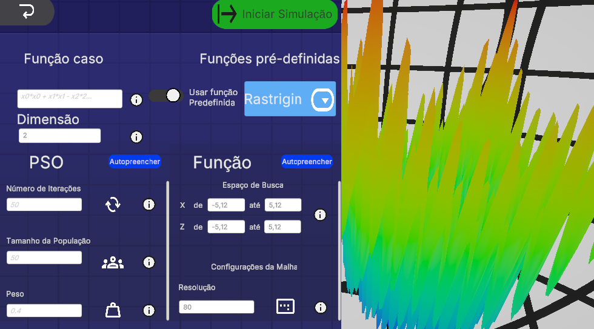

# Manual do Usuário — PSOnD

Este manual apresenta as instruções de instalação, configuração e operação do simulador tridimensional **PSOnD**, desenvolvido para a visualização e experimentação do algoritmo *Particle Swarm Optimization* (PSO). Esse manual também está disponível em PDF **[AQUI](https://github.com/vhogo004/psond/blob/main/manual_do_usuario.pdf)**.

> 📥 **Download:** Para baixar o simulador pronto para uso, acesse a aba **[Releases](https://github.com/vhogo004/psond/releases/tag/v1.0)** na lateral direita do repositório.

---

## 1. Requisitos do Sistema e Execução
* **Sistema Operacional:** Windows 10 ou Windows 11 (64 bits), ou Ubuntu 22.04 LTS ou superior (ou distribuições equivalentes de 64 bits).

* **Hardware Recomendado:** Processador dual-core ou superior, mínimo de $4\text{ GB}$ de memória RAM e placa gráfica com suporte a DirectX 11 ou DirectX 12.
* **Execução:** Não requer instalação de dependências externas. Basta rodar o executável disponibilizado na aba *Releases*, ou extrair o arquivo compactado e executar `PSOnD.exe`.

---

## 2. Tela Inicial e Configuração da Função Objetivo
Ao iniciar o simulador e pressionar o botão **"Começar"**, o usuário tem acesso ao painel de configuração da função objetivo e da malha tridimensional:

1. **Seleção de Função Predefinida:** Escolha entre as oito funções clássicas (*Sphere*, *Rastrigin*, *Ackley*, *Rosenbrock*, *Griewank*, *Himmelblau*, *Booth* e *Beale*). Ao selecionar uma função, os limites do domínio e os parâmetros visuais recomendados são preenchidos automaticamente.
2. **Inserção de Função Customizada:** Para avaliar uma expressão própria, digite a fórmula no campo de expressão seguindo as regras de sintaxe:
   * **Variáveis:** Devem ser indexadas sequencialmente a partir de zero (`x0`, `x1`, `x2`, ...), correspondendo exatamente à dimensão informada.
   * **Operadores e Constantes:** Suporta `+`, `-`, `*`, `/`, potenciação (`^`), parênteses e as constantes `pi` e `e`.
   * **Funções Suportadas:** `sin`, `cos`, `tan`, `asin`, `acos`, `atan`, `sqrt`, `abs`, `exp`, `ln`, `log`, `log10`, `pow`, `min` e `max`.
   * **Exemplo válido (2D):** `x0^2 + x1^2 - 10 * cos(2 * pi * x0) + 10`
3. **Dimensão ($D$):** Informe um número inteiro entre $2$ e $100$. Para $D > 2$, o simulador ativa automaticamente a projeção bidimensional via PCA.
4. **Parâmetros da Malha:** Ajuste a **Resolução** ($1$ a $800$), o **Espaçamento** ($> 0$ até $100$) e a **Escala da Altura Y** ($> 0$ até $100$). Para funções customizadas, utilize o botão de preenchimento recomendado para calcular automaticamente uma escala visual proporcional.

---

## 3. Configuração dos Parâmetros do PSO
Na etapa seguinte, definem-se os hiperparâmetros que governam o comportamento do enxame:

* **População ($N$):** Quantidade de partículas na simulação (inteiro de $1$ a $1000$; recomendado: $30$).
* **Iterações ($T_{\max}$):** Limite máximo de gerações da execução (inteiro de $1$ a $1000$; recomendado: $100$).
* **Peso de Inércia ($w$):** Controla a conservação da velocidade anterior (real entre $-1000$ e $1000$; recomendado: $0,4$).
* **Coeficiente Cognitivo ($c_1$):** Atração em direção à melhor posição individual (*pBest*) (real entre $-1000$ e $1000$; recomendado: $1,5$).
* **Coeficiente Social ($c_2$):** Atração em direção à melhor posição global (*gBest*) (real entre $-1000$ e $1000$; recomendado: $1,5$).

---

## 4. Controles da Simulação, Câmera e Inspeção
Durante a execução tridimensional, o usuário pode controlar o fluxo do algoritmo e navegar pelo cenário:

* **Controles de Execução:** Utilize os botões da barra superior/inferior para **Iniciar**, **Pausar/Retomar**, **Avançar Passo a Passo** (iteração única), **Reiniciar** ou **Encerrar** a simulação.
* **Navegação da Câmera:** Botão direito do mouse + arrastar para rotacionar, teclas `W`/`A`/`S`/`D`/ESPAÇO/'E'/SHIFT ESQUERDO/'Q' para movimentação livre, 'F' para focar em uma partícula e acompanhá-la, <kbd>←</kbd> e <kbd>→</kbd>  para selecionar nova partícula, `Scroll` para zoom e alternância entre câmera livre e orbital.
* **Painéis Laterais de Monitoramento:** O painel lateral esquerdo exibe a iteração atual, a melhor posição global (*gBest*) e o menor *fitness* encontrado. Ao clicar sobre qualquer partícula na cena, o painel direito exibe suas coordenadas atuais, velocidade e melhor histórico individual (*pBest*).

---

## 5. Mensagens de Validação e Solução de Problemas
Caso algum parâmetro inválido seja inserido antes do início da simulação, o sistema bloqueia a execução e exibe um aviso orientativo:

* *"Os índices das variáveis devem ser sequenciais começando de x0"*: Verifique se não há saltos na numeração (ex.: usar `x0 + x2` sem `x1`).
* *"A quantidade de variáveis não condiz com o total informado"*: Ajuste o campo de dimensão ($D$) para corresponder ao maior índice utilizado na expressão mais um.
* *"Valor fora do limite permitido"*: Certifique-se de que os campos numéricos respeitam os intervalos mínimos e máximos descritos nas Seções 2 e 3.
